# Project Pilot - PostgreSQL Database Schema & ER Model

## 1. Database Overview

- **DBMS**: PostgreSQL 16
- **Extensions**: `uuid-ossp`, `vector` (pgvector for native RAG embeddings)
- **Primary Keys**: UUID v4 (`uuid_generate_v4()`)
- **Audit Columns**: `created_at`, `updated_at`, `deleted_at` (soft deletion)
- **Performance**: Explicit indexes on all Foreign Keys & partial indexes on soft-deleted columns (`WHERE deleted_at IS NULL`).

---

## 2. Entity Relationship Diagram (ERD)

```mermaid
erDiagram
    users ||--o{ project_members : belongs_to
    roles ||--o{ user_roles : assigned_to
    users ||--o{ user_roles : has
    projects ||--o{ project_members : contains
    projects ||--o{ sources : has
    sources ||--o{ source_documents : contains
    source_documents ||--o{ source_embeddings : vectorizes
    projects ||--o{ requirements : generates
    projects ||--o{ features : generates
    projects ||--o{ architectures : generates
    architectures ||--o{ architecture_components : contains
    projects ||--o{ database_designs : generates
    database_designs ||--o{ database_entities : contains
    projects ||--o{ api_definitions : generates
    projects ||--o{ tech_stack_recommendations : recommends
    projects ||--o{ wireframes : generates
    projects ||--o{ sprints : plans
    sprints ||--o{ tasks : contains
    projects ||--o{ milestones : tracks
    projects ||--o{ cost_estimates : estimates
    projects ||--o{ risks : predicts
    projects ||--o{ documents : outputs
    projects ||--o{ conversations : hosts
    conversations ||--o{ messages : includes
    projects ||--o{ integrations : configures
    users ||--o{ notifications : receives
    projects ||--o{ activity_logs : records
    projects ||--o{ exports : exports
```



---

## 3. Comprehensive DDL Schema Specifications

```sql
CREATE EXTENSION IF NOT EXISTS "uuid-ossp";
CREATE EXTENSION IF NOT EXISTS "vector";

-- 1. USERS
CREATE TABLE users (
    id UUID PRIMARY KEY DEFAULT uuid_generate_v4(),
    email VARCHAR(255) UNIQUE NOT NULL,
    password_hash VARCHAR(255) NOT NULL,
    full_name VARCHAR(255) NOT NULL,
    avatar_url TEXT,
    is_active BOOLEAN DEFAULT TRUE,
    created_at TIMESTAMP WITH TIME ZONE DEFAULT CURRENT_TIMESTAMP,
    updated_at TIMESTAMP WITH TIME ZONE DEFAULT CURRENT_TIMESTAMP,
    deleted_at TIMESTAMP WITH TIME ZONE
);
CREATE INDEX idx_users_email ON users(email);
CREATE INDEX idx_users_active ON users(is_active) WHERE deleted_at IS NULL;

-- 2. ROLES
CREATE TABLE roles (
    id UUID PRIMARY KEY DEFAULT uuid_generate_v4(),
    name VARCHAR(50) UNIQUE NOT NULL
);

-- 3. USER_ROLES
CREATE TABLE user_roles (
    user_id UUID REFERENCES users(id) ON DELETE CASCADE,
    role_id UUID REFERENCES roles(id) ON DELETE CASCADE,
    PRIMARY KEY (user_id, role_id)
);

-- 4. PROJECTS
CREATE TABLE projects (
    id UUID PRIMARY KEY DEFAULT uuid_generate_v4(),
    title VARCHAR(255) NOT NULL,
    description TEXT,
    owner_id UUID NOT NULL REFERENCES users(id),
    status VARCHAR(50) DEFAULT 'PLANNING',
    health_score INT DEFAULT 100,
    created_at TIMESTAMP WITH TIME ZONE DEFAULT CURRENT_TIMESTAMP,
    updated_at TIMESTAMP WITH TIME ZONE DEFAULT CURRENT_TIMESTAMP,
    deleted_at TIMESTAMP WITH TIME ZONE
);
CREATE INDEX idx_projects_owner ON projects(owner_id);
CREATE INDEX idx_projects_active ON projects(id) WHERE deleted_at IS NULL;

-- 5. PROJECT_MEMBERS
CREATE TABLE project_members (
    id UUID PRIMARY KEY DEFAULT uuid_generate_v4(),
    project_id UUID NOT NULL REFERENCES projects(id) ON DELETE CASCADE,
    user_id UUID NOT NULL REFERENCES users(id) ON DELETE CASCADE,
    role_in_project VARCHAR(50) NOT NULL,
    created_at TIMESTAMP WITH TIME ZONE DEFAULT CURRENT_TIMESTAMP,
    UNIQUE(project_id, user_id)
);
CREATE INDEX idx_pm_project ON project_members(project_id);
CREATE INDEX idx_pm_user ON project_members(user_id);

-- 6. SOURCES
CREATE TABLE sources (
    id UUID PRIMARY KEY DEFAULT uuid_generate_v4(),
    project_id UUID NOT NULL REFERENCES projects(id) ON DELETE CASCADE,
    source_type VARCHAR(50) NOT NULL,
    url TEXT,
    title VARCHAR(255) NOT NULL,
    content_hash VARCHAR(64), -- SHA-256 hash to prevent duplicate AI parsing
    extracted_by UUID REFERENCES users(id),
    created_at TIMESTAMP WITH TIME ZONE DEFAULT CURRENT_TIMESTAMP
);
CREATE INDEX idx_sources_project ON sources(project_id);
CREATE INDEX idx_sources_hash ON sources(content_hash);

-- 7. SOURCE_DOCUMENTS
CREATE TABLE source_documents (
    id UUID PRIMARY KEY DEFAULT uuid_generate_v4(),
    source_id UUID NOT NULL REFERENCES sources(id) ON DELETE CASCADE,
    raw_content TEXT NOT NULL,
    normalized_content TEXT,
    metadata JSONB,
    created_at TIMESTAMP WITH TIME ZONE DEFAULT CURRENT_TIMESTAMP
);
CREATE INDEX idx_source_docs_source ON source_documents(source_id);

-- 8. SOURCE_EMBEDDINGS (pgvector RAG compatibility)
CREATE TABLE source_embeddings (
    id UUID PRIMARY KEY DEFAULT uuid_generate_v4(),
    source_document_id UUID NOT NULL REFERENCES source_documents(id) ON DELETE CASCADE,
    chunk_index INT NOT NULL,
    chunk_text TEXT NOT NULL,
    embedding vector(1536), -- Vector embedding for LangChain RAG search
    created_at TIMESTAMP WITH TIME ZONE DEFAULT CURRENT_TIMESTAMP
);
CREATE INDEX idx_embeddings_doc ON source_embeddings(source_document_id);

-- 9. REQUIREMENTS
CREATE TABLE requirements (
    id UUID PRIMARY KEY DEFAULT uuid_generate_v4(),
    project_id UUID NOT NULL REFERENCES projects(id) ON DELETE CASCADE,
    req_code VARCHAR(50) NOT NULL,
    title VARCHAR(255) NOT NULL,
    description TEXT NOT NULL,
    category VARCHAR(50) NOT NULL,
    priority VARCHAR(20) NOT NULL,
    confidence_score NUMERIC(3,2),
    dependencies JSONB,
    created_at TIMESTAMP WITH TIME ZONE DEFAULT CURRENT_TIMESTAMP,
    updated_at TIMESTAMP WITH TIME ZONE DEFAULT CURRENT_TIMESTAMP
);
CREATE INDEX idx_requirements_project ON requirements(project_id);
CREATE INDEX idx_requirements_category ON requirements(category);

-- 10. FEATURES
CREATE TABLE features (
    id UUID PRIMARY KEY DEFAULT uuid_generate_v4(),
    project_id UUID NOT NULL REFERENCES projects(id) ON DELETE CASCADE,
    feature_code VARCHAR(50) NOT NULL,
    title VARCHAR(255) NOT NULL,
    description TEXT NOT NULL,
    category VARCHAR(50) NOT NULL,
    priority VARCHAR(20) NOT NULL,
    complexity VARCHAR(20) NOT NULL,
    created_at TIMESTAMP WITH TIME ZONE DEFAULT CURRENT_TIMESTAMP
);
CREATE INDEX idx_features_project ON features(project_id);

-- 11. ARCHITECTURES
CREATE TABLE architectures (
    id UUID PRIMARY KEY DEFAULT uuid_generate_v4(),
    project_id UUID NOT NULL REFERENCES projects(id) ON DELETE CASCADE,
    style VARCHAR(100) NOT NULL,
    summary TEXT NOT NULL,
    mermaid_diagram TEXT NOT NULL,
    created_at TIMESTAMP WITH TIME ZONE DEFAULT CURRENT_TIMESTAMP
);
CREATE INDEX idx_architectures_project ON architectures(project_id);

-- 12. ARCHITECTURE_COMPONENTS
CREATE TABLE architecture_components (
    id UUID PRIMARY KEY DEFAULT uuid_generate_v4(),
    architecture_id UUID NOT NULL REFERENCES architectures(id) ON DELETE CASCADE,
    name VARCHAR(255) NOT NULL,
    tech_stack VARCHAR(255) NOT NULL,
    responsibility TEXT NOT NULL,
    communication_protocol VARCHAR(100) NOT NULL,
    created_at TIMESTAMP WITH TIME ZONE DEFAULT CURRENT_TIMESTAMP
);
CREATE INDEX idx_arch_comp_arch ON architecture_components(architecture_id);

-- 13. DATABASE_DESIGNS
CREATE TABLE database_designs (
    id UUID PRIMARY KEY DEFAULT uuid_generate_v4(),
    project_id UUID NOT NULL REFERENCES projects(id) ON DELETE CASCADE,
    db_type VARCHAR(50) NOT NULL,
    mermaid_er_diagram TEXT NOT NULL,
    migration_sql TEXT NOT NULL,
    created_at TIMESTAMP WITH TIME ZONE DEFAULT CURRENT_TIMESTAMP
);
CREATE INDEX idx_db_designs_project ON database_designs(project_id);

-- 14. DATABASE_ENTITIES
CREATE TABLE database_entities (
    id UUID PRIMARY KEY DEFAULT uuid_generate_v4(),
    database_design_id UUID NOT NULL REFERENCES database_designs(id) ON DELETE CASCADE,
    table_name VARCHAR(100) NOT NULL,
    columns_spec JSONB NOT NULL,
    created_at TIMESTAMP WITH TIME ZONE DEFAULT CURRENT_TIMESTAMP
);
CREATE INDEX idx_db_entities_design ON database_entities(database_design_id);

-- 15. API_DEFINITIONS
CREATE TABLE api_definitions (
    id UUID PRIMARY KEY DEFAULT uuid_generate_v4(),
    project_id UUID NOT NULL REFERENCES projects(id) ON DELETE CASCADE,
    endpoint_path VARCHAR(255) NOT NULL,
    http_method VARCHAR(10) NOT NULL,
    summary VARCHAR(255) NOT NULL,
    request_schema JSONB,
    response_schema JSONB,
    auth_required BOOLEAN DEFAULT TRUE,
    created_at TIMESTAMP WITH TIME ZONE DEFAULT CURRENT_TIMESTAMP
);
CREATE INDEX idx_api_defs_project ON api_definitions(project_id);

-- 16. TECH_STACK_RECOMMENDATIONS
CREATE TABLE tech_stack_recommendations (
    id UUID PRIMARY KEY DEFAULT uuid_generate_v4(),
    project_id UUID NOT NULL REFERENCES projects(id) ON DELETE CASCADE,
    category VARCHAR(50) NOT NULL,
    technology_name VARCHAR(100) NOT NULL,
    justification TEXT NOT NULL,
    created_at TIMESTAMP WITH TIME ZONE DEFAULT CURRENT_TIMESTAMP
);
CREATE INDEX idx_tech_stack_project ON tech_stack_recommendations(project_id);

-- 17. WIREFRAMES
CREATE TABLE wireframes (
    id UUID PRIMARY KEY DEFAULT uuid_generate_v4(),
    project_id UUID NOT NULL REFERENCES projects(id) ON DELETE CASCADE,
    page_name VARCHAR(100) NOT NULL,
    layout_description TEXT NOT NULL,
    components_list JSONB NOT NULL,
    created_at TIMESTAMP WITH TIME ZONE DEFAULT CURRENT_TIMESTAMP
);
CREATE INDEX idx_wireframes_project ON wireframes(project_id);

-- 18. SPRINTS
CREATE TABLE sprints (
    id UUID PRIMARY KEY DEFAULT uuid_generate_v4(),
    project_id UUID NOT NULL REFERENCES projects(id) ON DELETE CASCADE,
    name VARCHAR(100) NOT NULL,
    goal TEXT,
    start_date DATE,
    end_date DATE,
    status VARCHAR(50) DEFAULT 'PLANNED',
    created_at TIMESTAMP WITH TIME ZONE DEFAULT CURRENT_TIMESTAMP
);
CREATE INDEX idx_sprints_project ON sprints(project_id);

-- 19. TASKS
CREATE TABLE tasks (
    id UUID PRIMARY KEY DEFAULT uuid_generate_v4(),
    sprint_id UUID REFERENCES sprints(id) ON DELETE SET NULL,
    project_id UUID NOT NULL REFERENCES projects(id) ON DELETE CASCADE,
    title VARCHAR(255) NOT NULL,
    description TEXT,
    status VARCHAR(50) DEFAULT 'TODO',
    priority VARCHAR(20) DEFAULT 'MEDIUM',
    story_points INT DEFAULT 1,
    assignee_id UUID REFERENCES users(id),
    created_at TIMESTAMP WITH TIME ZONE DEFAULT CURRENT_TIMESTAMP,
    updated_at TIMESTAMP WITH TIME ZONE DEFAULT CURRENT_TIMESTAMP
);
CREATE INDEX idx_tasks_project ON tasks(project_id);
CREATE INDEX idx_tasks_sprint ON tasks(sprint_id);
CREATE INDEX idx_tasks_assignee ON tasks(assignee_id);

-- 20. MILESTONES
CREATE TABLE milestones (
    id UUID PRIMARY KEY DEFAULT uuid_generate_v4(),
    project_id UUID NOT NULL REFERENCES projects(id) ON DELETE CASCADE,
    title VARCHAR(255) NOT NULL,
    target_date DATE NOT NULL,
    deliverables TEXT NOT NULL,
    is_completed BOOLEAN DEFAULT FALSE,
    created_at TIMESTAMP WITH TIME ZONE DEFAULT CURRENT_TIMESTAMP
);
CREATE INDEX idx_milestones_project ON milestones(project_id);

-- 21. COST_ESTIMATES
CREATE TABLE cost_estimates (
    id UUID PRIMARY KEY DEFAULT uuid_generate_v4(),
    project_id UUID NOT NULL REFERENCES projects(id) ON DELETE CASCADE,
    dev_cost NUMERIC(12,2) NOT NULL,
    infra_cost NUMERIC(12,2) NOT NULL,
    ai_api_cost NUMERIC(12,2) NOT NULL,
    maintenance_cost NUMERIC(12,2) NOT NULL,
    total_cost NUMERIC(12,2) NOT NULL,
    currency VARCHAR(10) DEFAULT 'USD',
    assumptions TEXT NOT NULL,
    created_at TIMESTAMP WITH TIME ZONE DEFAULT CURRENT_TIMESTAMP
);
CREATE INDEX idx_costs_project ON cost_estimates(project_id);

-- 22. RISKS
CREATE TABLE risks (
    id UUID PRIMARY KEY DEFAULT uuid_generate_v4(),
    project_id UUID NOT NULL REFERENCES projects(id) ON DELETE CASCADE,
    risk_code VARCHAR(50) NOT NULL,
    category VARCHAR(50) NOT NULL,
    description TEXT NOT NULL,
    probability VARCHAR(20) NOT NULL,
    impact VARCHAR(20) NOT NULL,
    severity_score INT NOT NULL,
    mitigation_strategy TEXT NOT NULL,
    created_at TIMESTAMP WITH TIME ZONE DEFAULT CURRENT_TIMESTAMP
);
CREATE INDEX idx_risks_project ON risks(project_id);

-- 23. DOCUMENTS
CREATE TABLE documents (
    id UUID PRIMARY KEY DEFAULT uuid_generate_v4(),
    project_id UUID NOT NULL REFERENCES projects(id) ON DELETE CASCADE,
    doc_type VARCHAR(50) NOT NULL,
    title VARCHAR(255) NOT NULL,
    content_markdown TEXT NOT NULL,
    created_at TIMESTAMP WITH TIME ZONE DEFAULT CURRENT_TIMESTAMP
);
CREATE INDEX idx_documents_project ON documents(project_id);

-- 24. CONVERSATIONS
CREATE TABLE conversations (
    id UUID PRIMARY KEY DEFAULT uuid_generate_v4(),
    project_id UUID NOT NULL REFERENCES projects(id) ON DELETE CASCADE,
    title VARCHAR(255) DEFAULT 'New AI Architecture Session',
    created_by UUID REFERENCES users(id),
    created_at TIMESTAMP WITH TIME ZONE DEFAULT CURRENT_TIMESTAMP
);
CREATE INDEX idx_conversations_project ON conversations(project_id);

-- 25. MESSAGES
CREATE TABLE messages (
    id UUID PRIMARY KEY DEFAULT uuid_generate_v4(),
    conversation_id UUID NOT NULL REFERENCES conversations(id) ON DELETE CASCADE,
    sender VARCHAR(20) NOT NULL,
    content TEXT NOT NULL,
    context_snapshot JSONB,
    created_at TIMESTAMP WITH TIME ZONE DEFAULT CURRENT_TIMESTAMP
);
CREATE INDEX idx_messages_conv ON messages(conversation_id);

-- 26. INTEGRATIONS
CREATE TABLE integrations (
    id UUID PRIMARY KEY DEFAULT uuid_generate_v4(),
    project_id UUID NOT NULL REFERENCES projects(id) ON DELETE CASCADE,
    provider VARCHAR(50) NOT NULL,
    encrypted_credentials TEXT NOT NULL,
    is_active BOOLEAN DEFAULT TRUE,
    created_at TIMESTAMP WITH TIME ZONE DEFAULT CURRENT_TIMESTAMP
);
CREATE INDEX idx_integrations_project ON integrations(project_id);

-- 27. NOTIFICATIONS
CREATE TABLE notifications (
    id UUID PRIMARY KEY DEFAULT uuid_generate_v4(),
    user_id UUID NOT NULL REFERENCES users(id) ON DELETE CASCADE,
    title VARCHAR(255) NOT NULL,
    message TEXT NOT NULL,
    is_read BOOLEAN DEFAULT FALSE,
    created_at TIMESTAMP WITH TIME ZONE DEFAULT CURRENT_TIMESTAMP
);
CREATE INDEX idx_notifications_user ON notifications(user_id);

-- 28. ACTIVITY_LOGS
CREATE TABLE activity_logs (
    id UUID PRIMARY KEY DEFAULT uuid_generate_v4(),
    project_id UUID NOT NULL REFERENCES projects(id) ON DELETE CASCADE,
    user_id UUID REFERENCES users(id),
    action VARCHAR(100) NOT NULL,
    details TEXT,
    created_at TIMESTAMP WITH TIME ZONE DEFAULT CURRENT_TIMESTAMP
);
CREATE INDEX idx_activity_project ON activity_logs(project_id);

-- 29. EXPORTS
CREATE TABLE exports (
    id UUID PRIMARY KEY DEFAULT uuid_generate_v4(),
    project_id UUID NOT NULL REFERENCES projects(id) ON DELETE CASCADE,
    export_format VARCHAR(20) NOT NULL,
    file_path TEXT NOT NULL,
    created_at TIMESTAMP WITH TIME ZONE DEFAULT CURRENT_TIMESTAMP
);
CREATE INDEX idx_exports_project ON exports(project_id);
```
