# Project Pilot – AI-Powered Software Planning & Architecture Assistant
## Comprehensive Project Documentation & Technical Specification Report

---

## 1. Executive Summary & Project Overview

### 1.1 Project Title
**Project Pilot: An Enterprise-Grade AI-Driven Software Planning, Architecture Generation, and Technical Specification Platform**

### 1.2 Abstract
In contemporary software engineering, the initial discovery, planning, and architectural design phases represent significant cost centers and time sinks. Software architects, project managers, and lead engineers spend dozens of hours analyzing fragmented inputs—such as competitor websites, GitHub repositories, client briefs, Figma mockups, and technical documents—to construct Software Requirements Specifications (SRS), database schemas, component architectures, API designs, sprint plans, and financial/risk estimates.

**Project Pilot** solves this bottleneck by providing an end-to-end, automated AI software planning assistant. Configured as a modular monorepo, Project Pilot leverages a **Manifest V3 Chrome Extension** for real-time web and repository content extraction, a **React 18 + Vite Web Dashboard** for visual project management, a **Spring Boot 3.2 (Java 17)** backend for business logic and RBAC orchestration, an isolated **FastAPI (Python 3.11)** microservice executing domain-specific generative models (Google Gemini 1.5/2.0), and a **PostgreSQL 16** database equipped with `pgvector` for Retrieval-Augmented Generation (RAG). Project Pilot delivers verifiable, production-grade technical artifacts in seconds while strictly mitigating AI hallucinations through a deterministic self-repair validation pipeline.

### 1.3 Problem Statement
Traditional software planning suffers from severe deficiencies:
1. **Fragmented Workflows**: Teams juggle Google Docs, Jira, Draw.io, Swagger Hub, and Excel sheets with zero semantic linkage.
2. **High Cognitive & Financial Overhead**: Formulating SRS, architectural diagrams, and DDL scripts requires senior engineering expertise and weeks of preliminary consulting.
3. **Lack of Verifiable Grounding**: Generative AI tools (e.g., standard ChatGPT prompts) frequently hallucinate non-existent libraries, invalid SQL DDL, or malformed JSON payloads that break downstream systems.
4. **Context Loss Across Ingestions**: Analyzing competitor web applications or open-source repositories requires manual copying, pasting, and summarizing.

### 1.4 Objectives & Project Scope
- **Automated Ingestion**: Ingest live web pages, GitHub repositories, Figma URLs, and technical documentation via a single browser click or dashboard upload.
- **17 Specialized AI Analyzers**: Modular microservice analyzers for Requirements, Feature Breakdown, System Architecture, Database Schema, REST APIs, Sprint Backlogs, Cost Modeling, and Risk Scoring.
- **Strict Anti-Hallucination Framework**: Classify all generated intelligence into a 5-tier taxonomy (`FACT`, `INFERENCE`, `RECOMMENDATION`, `ASSUMPTION`, `UNKNOWN`).
- **Deterministic Output Validation**: Guarantee strict JSON schema conformance using Pydantic v2 and an automated self-healing retry mechanism.
- **Visual Artifacts Generation**: Instant generation of Mermaid.js architecture diagrams, Entity-Relationship schemas, and Gantt charts directly within the dashboard.

---

## 2. Existing System vs. Proposed System

### 2.1 Existing System Analysis
In existing organizational workflows, software project inception is largely manual and fragmented:
- **Requirements Gathering**: Conducted via recurring client meetings, recorded transcripts, and unorganized text notes.
- **System Architecture & Modeling**: Architects manually sketch diagrams in Draw.io, Lucidchart, or Microsoft Visio without synchronized code or API specifications.
- **Database Design**: DBA engineers draft schema SQL files independently, often causing mismatch with application object-relational mapping (ORM) entities.
- **API Specification**: Backends create Postman collections or OpenAPI files post-implementation rather than contract-first.
- **Project Planning**: Project managers guess sprint timelines, story points, and budget projections using spreadsheets or Jira.

### 2.2 Drawbacks of the Existing System
- **Time Consuming**: Generating an end-to-end technical proposal and SRS takes 2 to 4 weeks.
- **High Human Error**: Inconsistencies between the database schema, business requirements, and API definitions.
- **Expensive**: Requires billable hours from senior technical architects, analysts, and project managers.
- **No Direct Web Ingestion**: Engineers must manually inspect websites, DOM elements, and competitor repos to formulate specifications.
- **Zero Real-Time Verification**: Outdated documentation that diverges from the codebase as changes occur.

### 2.3 Proposed System (Project Pilot)
Project Pilot automates the entire discovery-to-specification lifecycle. The user can capture an active webpage or repository via the Manifest V3 Chrome Extension or input raw client requirements into the React SaaS Dashboard. The Spring Boot backend securely persists source records and delegates tasks to the Python AI microservice. Using Google Gemini 1.5/2.0 with Pydantic validation and LangChain RAG, Project Pilot decomposes the project into complete functional/non-functional requirements, Mermaid architecture diagrams, PostgreSQL DDL schemas, OpenAPI 3.0 contracts, sprint backlogs, and cloud infrastructure cost estimates.

### 2.4 Comparison Table: Existing vs. Proposed System

| Parameter | Existing System (Manual / Legacy) | Proposed System (Project Pilot) |
| :--- | :--- | :--- |
| **Turnaround Time** | 2 to 4 weeks for initial architecture & SRS | Under 60 seconds for complete architectural blueprint |
| **Input Sources** | Disjointed notes, emails, and manual copy-pasting | One-click Chrome Extension DOM capture, GitHub repo ingestion, raw text |
| **Architectural Diagrams** | Manually drawn in Draw.io/Visio; static and unsynced | Auto-generated standard Mermaid.js diagrams rendered dynamically |
| **Database Schema** | Written by hand; prone to syntax and normalization bugs | Automated, normalized PostgreSQL DDL with foreign keys and indexes |
| **API Specifications** | Manually constructed after coding; often obsolete | Contract-first OpenAPI 3.0 / Swagger JSON generated upfront |
| **Sprint & Cost Estimation**| Subjective human guesses based on intuition | AI algorithmic estimation with story points, milestone schedules & cloud cost |
| **Risk Prediction** | Reactive; risks identified after project bottlenecks occur | Proactive 1–10 severity risk matrix identifying technical and business pitfalls |
| **Hallucination Prevention**| N/A (Standard LLMs invent libraries and hallucinate) | Strict 5-tier taxonomy (`FACT`, `INFERENCE`, etc.) + 2-stage Pydantic self-repair |
| **Access Control & Roles** | Siloed document permissions or all-or-nothing access | Enterprise RBAC with 8 granular roles (`ADMIN`, `DEVELOPER`, `STUDENT`, etc.) |

---

## 3. Hardware & Software Requirements

### 3.1 Hardware Requirements

#### A. Development & Local Testing Environment
- **Processor**: Intel Core i5 / AMD Ryzen 5 (4 Cores, 8 Threads) or Apple Silicon (M1/M2/M3)
- **RAM**: Minimum 8 GB (16 GB Recommended for running Docker containers concurrently)
- **Storage**: Minimum 20 GB free disk space (SSD recommended for Docker images & PostgreSQL)
- **Display Resolution**: 1920 × 1080 pixels (Full HD)
- **Network**: Broadband Internet connection (minimum 10 Mbps) for Gemini API streaming and package resolution

#### B. Production Server Deployment Environment
- **Server Instance**: 2 vCPU, 4 GB RAM (Small production) / 4 vCPU, 8 GB RAM (Enterprise)
- **Operating System**: Ubuntu 22.04 LTS / Debian 12 / Alpine Linux (via Docker containers)
- **Storage**: 50 GB NVMe SSD (Scalable EBS or Cloud Managed Disk)
- **Network Bandwidth**: High-speed dedicated 100 Mbps+ interface with HTTPS (TLS 1.3) SSL termination

#### C. Client Machine / End-User Specifications
- **Device**: Any Desktop, Laptop, or Tablet capable of running a modern web browser
- **RAM**: Minimum 4 GB RAM
- **Browser**: Google Chrome v110+ (for Chrome Extension & Dashboard), Mozilla Firefox, Apple Safari, or Microsoft Edge

---

### 3.2 Software Requirements

#### A. Operating Systems Supported
- Microsoft Windows 10 / 11 (64-bit)
- macOS Monterey / Ventura / Sonoma
- Linux (Ubuntu, Fedora, CentOS, Arch Linux)

#### B. Programming Languages & Runtimes
- **Java**: OpenJDK 17 LTS (Java Development Kit)
- **Python**: Python 3.11.x or 3.12.x
- **JavaScript / TypeScript**: Node.js v20.x LTS, TypeScript 5.5.x

#### C. Backend Frameworks & Libraries
- **Spring Boot 3.2.5**: Core enterprise REST framework
- **Spring Security 6**: Authentication & Authorization filters
- **Spring Data JPA / Hibernate 6**: Object-Relational Mapping
- **jjwt (io.jsonwebtoken 0.12.5)**: HMAC-SHA256 JWT generation and validation
- **Flyway Database Migration (10.10.0)**: Automated SQL schema versioning
- **Springdoc OpenAPI (2.5.0)**: Automatic Swagger UI documentation
- **Lombok**: Boilerplate reduction for Java models and DTOs

#### D. AI Microservice Frameworks & Libraries
- **FastAPI 0.111.0**: High-performance asynchronous Python web framework
- **Uvicorn 0.30.1**: ASGI production server
- **Pydantic v2.8.2**: Runtime type validation and deterministic JSON schema extraction
- **Google Generative AI SDK (0.7.2)**: Integration with Gemini 1.5 Pro and Gemini 1.5 Flash
- **LangChain / LangChain-Community**: Prompt templating and RAG chains
- **HTTPX 0.27.0**: Async HTTP client for inter-service communication

#### E. Frontend Dashboard & Chrome Extension Technologies
- **React 18.3.1**: Declarative UI component tree
- **Vite 5.3.4**: Lightning-fast frontend build tooling and HMR
- **Tailwind CSS 3.4.6**: Utility-first responsive styling
- **TanStack React Query 5.51.11**: Asynchronous server state caching and synchronization
- **Mermaid.js 10.9.1**: Dynamic browser-side rendering of architecture and ER diagrams
- **Recharts 2.12.7**: Analytical dashboards, velocity charts, and cost breakdown visuals
- **Lucide React 0.414.0**: Clean, modern iconography
- **Chrome Manifest V3 API**: Background service worker, tabs, activeTab, and script injection

#### F. Database & Persistence Layer
- **PostgreSQL 16**: Relational ACID database
- **Extensions**: `uuid-ossp` (UUID v4 generation), `vector` (pgvector 1536-dim semantic search)
- **H2 Database**: In-memory relational database for unit and integration testing

#### G. DevOps, Orchestration & Tooling
- **Docker & Docker Compose v2**: Multi-container orchestration
- **Apache Maven 3.9+**: Java dependency management and build lifecycle
- **npm Workspaces**: Monorepo package management
- **Git & GitHub**: Version control and CI/CD pipelines

---

## 4. Requirements Specification

### 4.1 Functional Requirements (FR)

- **FR-01: User Authentication & Role-Based Authorization**
  - Users must register with email, password, full name, and assignable role (`DEVELOPER`, `PROJECT_MANAGER`, `ADMIN`, etc.).
  - Passwords must be hashed using BCrypt (strength 12).
  - Stateless JWT tokens (HMAC-SHA256) must be issued upon login with a configurable 24-hour expiration.
  - Endpoints must enforce role permissions via Spring Security method annotations.

- **FR-02: Multi-Source Content Ingestion**
  - The Chrome Extension must capture the sanitized DOM text, meta tags, and code blocks from active tabs.
  - The system must classify sources into `WEBSITE`, `GITHUB_REPO`, `FIGMA_DESIGN`, `TECHNICAL_DOC`, or `MANUAL_PROMPT`.
  - Raw source documents must be persisted with source URLs, raw payloads, and timestamps.

- **FR-03: AI Requirement & Feature Engineering**
  - The AI microservice must analyze source documents to produce Functional Requirements (FR), Non-Functional Requirements (NFR), and User Stories with acceptance criteria.
  - Features must be classified into Core, Secondary, Future, and Innovative categories with priority ratings (`CRITICAL`, `HIGH`, `MEDIUM`, `LOW`).

- **FR-04: System Architecture & Mermaid Diagram Generation**
  - Automatically formulate architectural component breakdowns, data flows, communication protocols, and deployment models.
  - Output syntactically valid Mermaid.js diagrams ready for dynamic UI visualization.

- **FR-05: Database Schema Design & DDL Generation**
  - Synthesize normalized third-normal-form (3NF) relational database models.
  - Generate copy-pasteable PostgreSQL DDL SQL with foreign keys, cascading rules, and performance indexes.
  - Generate Mermaid ER diagrams showing entity relationships.

- **FR-06: API Contract Specification**
  - Generate comprehensive OpenAPI 3.0 / Swagger JSON specifications.
  - Specify HTTP methods, request bodies, query parameters, header requirements, and 2xx/4xx/5xx response envelopes.

- **FR-07: Sprint Planning & Task Allocation**
  - Decompose project features into actionable Agile sprint cycles (Sprint 1, Sprint 2, etc.).
  - Break sprints into discrete engineering tasks with Fibonacci story point allocations and role assignments.
  - Display tasks on an interactive Kanban board (`TODO`, `IN_PROGRESS`, `BLOCKED`, `DONE`).

- **FR-08: Cost & Risk Estimation**
  - Calculate cloud infrastructure expenditure estimates (compute, database, storage, networking, AI inference).
  - Produce a 1–10 severity risk matrix identifying operational, architectural, and security vulnerabilities with mitigation strategies.

- **FR-09: Contextual AI Project Assistant**
  - Provide an in-dashboard conversational AI assistant grounded strictly in the project’s specific persisted requirements and database design.

- **FR-10: Multi-Format Document Export**
  - Export complete software documentation in Markdown (.md), PDF, and OpenAPI JSON formats for immediate executive presentation.

---

### 4.2 Non-Functional Requirements (NFR)

- **NFR-01: Performance & Response Time**
  - Core Spring Boot REST CRUD operations must respond in $< 150 \text{ ms}$.
  - AI generation endpoints must stream or return completed structured responses within 10–25 seconds depending on document size.
  - React Web Dashboard initial bundle load must occur in $< 2.0 \text{ s}$.

- **NFR-02: Security & Credential Isolation**
  - Gemini API keys, OAuth secrets, and database credentials must remain strictly server-side; zero secrets exposed to client browsers or extensions.
  - All inter-service communications must use HTTPS with strict CORS policies.
  - SQL injection prevented via Spring Data JPA parameterized queries; XSS prevented via React automated sanitization.

- **NFR-03: Reliability & Determinism**
  - AI generation failures due to LLM malformed JSON must trigger the self-repair loop (up to 2 retries) before throwing a graceful user exception.
  - 99.9% uptime for core database and REST CRUD microservices.

- **NFR-04: Scalability**
  - Stateless Spring Boot backend and FastAPI AI service allow horizontal pod autoscaling behind a reverse proxy (e.g., Nginx or Kubernetes Ingress).
  - PostgreSQL database supports connection pooling via HikariCP with indexed foreign keys.

- **NFR-05: Maintainability & Modularity**
  - Modular monorepo with strict package boundaries (`packages/shared-types`).
  - Python AI microservice organized into 17 decoupled analyzer engines adhering to Single Responsibility Principle (SRP).

- **NFR-06: Usability & User Experience**
  - Intuitive dark-mode enabled SaaS interface with responsive Tailwind CSS.
  - Real-time visual diagrams rendered client-side with Mermaid.js without requiring third-party graphic plugins.

---

## 5. System Architecture

### 5.1 Architectural Pattern
Project Pilot is engineered using a **Decoupled Microservice & Modular Monorepo Architecture**:
1. **Client Tier**:
   - **Chrome Extension (Manifest V3)**: Captures active tab context and communicates with backend via REST.
   - **React SaaS Dashboard**: Single Page Application (SPA) serving as the command center for visualization and editing.
2. **Gateway & Business Logic Tier**:
   - **Spring Boot 3.2 Core Backend**: Handles JWT security, transactional data persistence, team collaboration, and orchestrates calls to the AI engine.
3. **AI Inference Tier**:
   - **FastAPI AI Microservice**: Houses the 17 modular analyzer engines, LangChain prompts, and Pydantic validation schemas.
4. **Data & Persistence Tier**:
   - **PostgreSQL 16**: Relational storage for 28 relational entities with pgvector embedding support.
5. **External Services Tier**:
   - **Google Gemini API**: Server-side multimodal LLM inference (Gemini 1.5 Pro / Flash).

---

### 5.2 System Architecture Diagram (Mermaid)

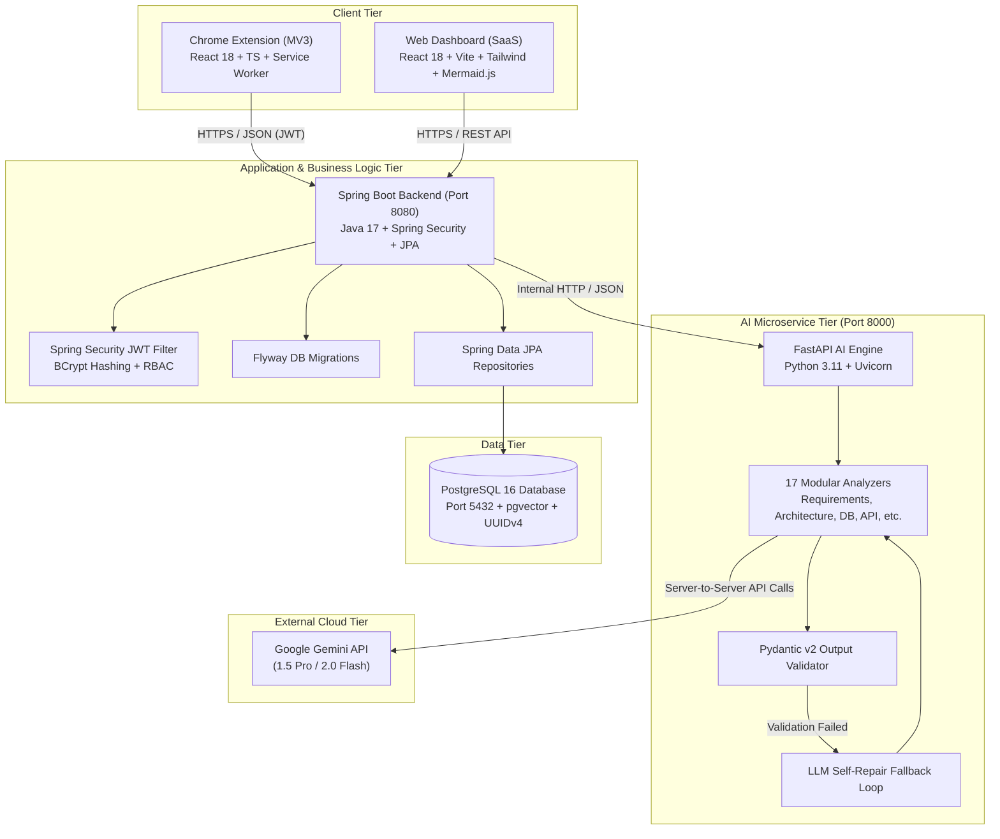

---

## 6. Data Flow Diagrams (DFD)

### 6.1 DFD Level 0 (Context Level Diagram)
The Context Diagram establishes the boundary between Project Pilot and external entities (Users, Browsers, and External AI APIs).

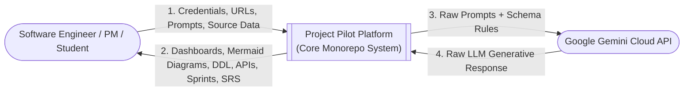

---

### 6.2 DFD Level 1 (Top-Level Process Flow)
Decomposes the system into its 5 primary processes: Authentication, Source Ingestion, AI Processing, Project Management & Visualization, and Artifact Export.

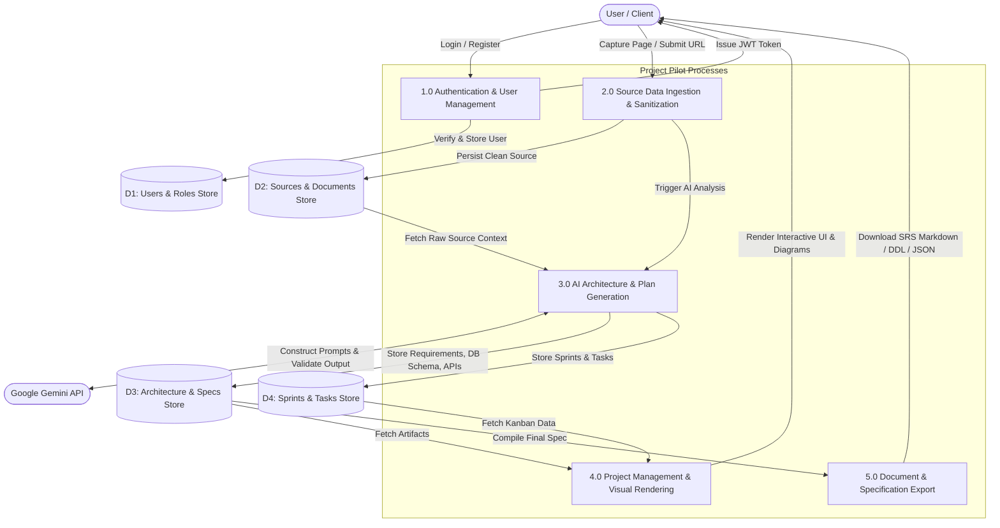

---

### 6.3 DFD Level 2 (AI Generation & Self-Repair Pipeline)
Detailed decomposition of process **3.0: AI Architecture & Plan Generation**.

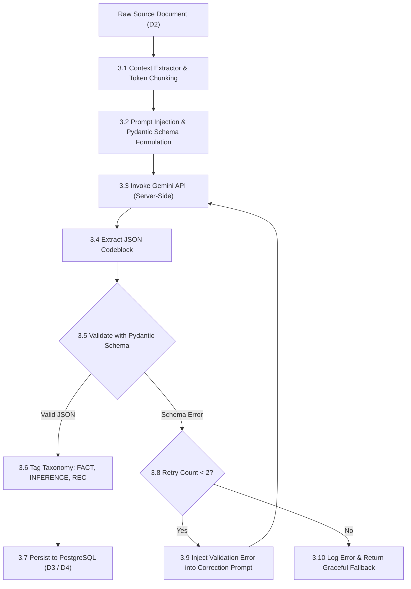

---

## 7. Complete Suite of UML Diagrams

### 7.1 Use Case Diagram
Illustrates the interactions between the system actors (**Software Developer**, **Project Manager**, **System Administrator**, and the **AI Analyzer Service**) and the core functional use cases.

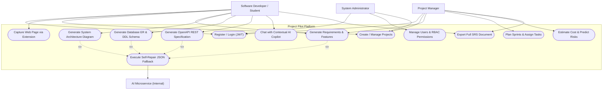

---

### 7.2 Class Diagram
Represents the core Object-Oriented Domain Entities, their attributes, visibility, methods, and relationships in the Spring Boot backend.

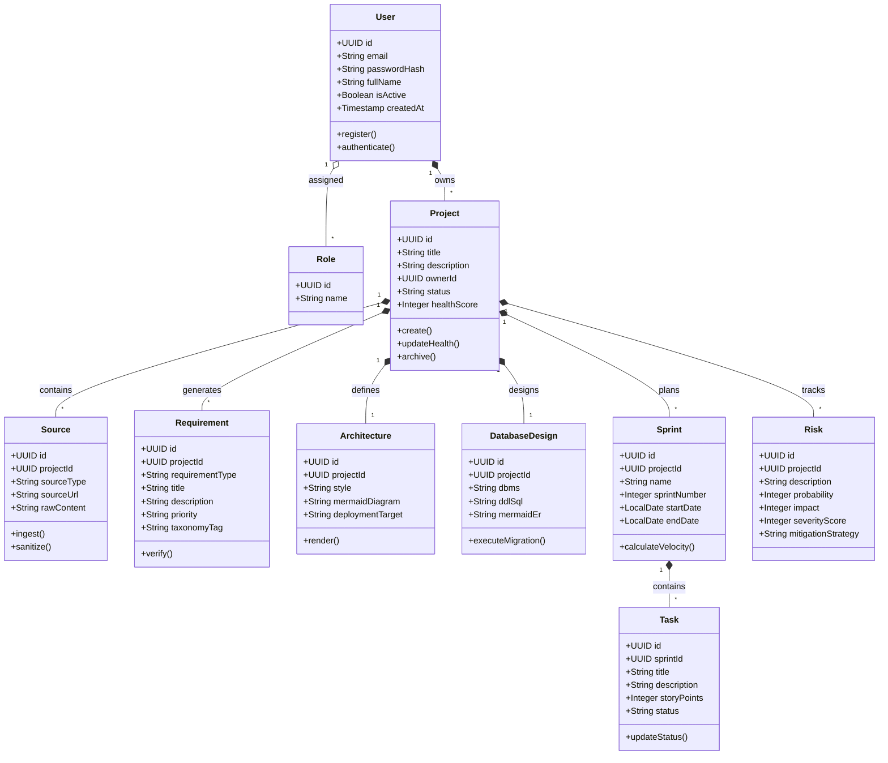

---

### 7.3 Sequence Diagram
Details the runtime message passing across subsystems during the End-to-End Analysis Workflow (from User input in Chrome Extension to Backend, AI Microservice, Gemini API, and Dashboard Rendering).

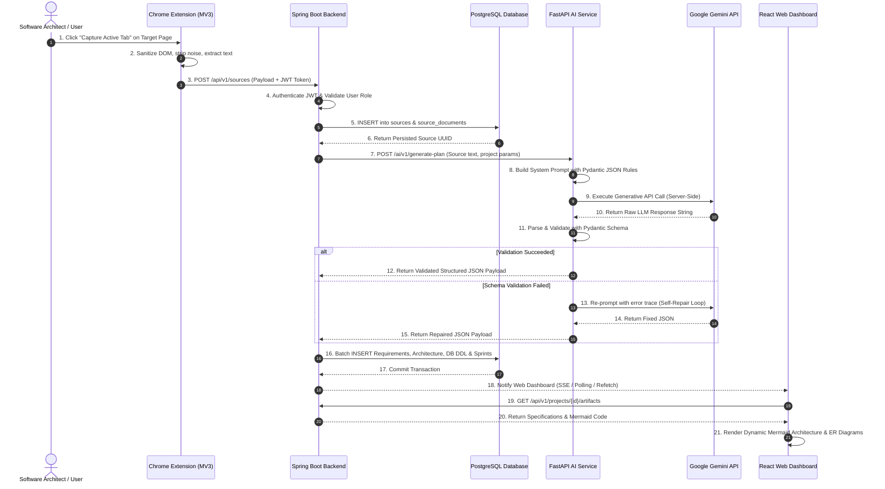

---

### 7.4 Activity Diagram
Represents the operational step-by-step workflow of generating a project specification, including branching decisions and validation fallback loops.

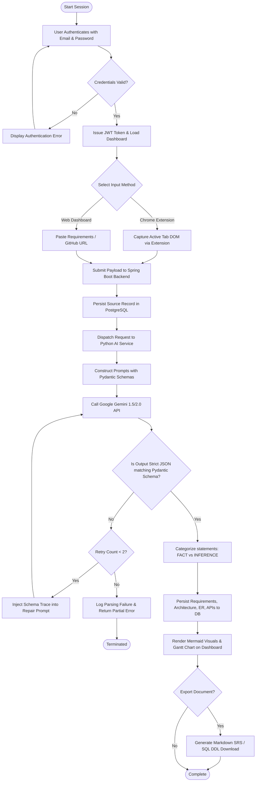

---

### 7.5 State Machine Diagram
Tracks the lifecycle states of a Project and its corresponding AI Planning Generation jobs.

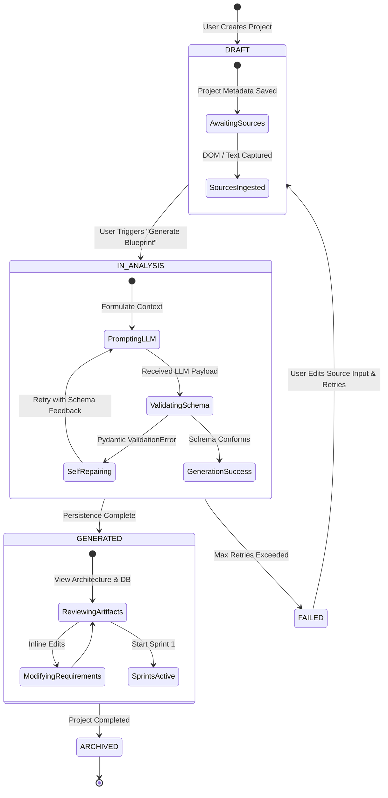

---

### 7.6 Component Diagram
Demonstrates the high-level software components, interfaces, and protocol bindings that constitute Project Pilot.

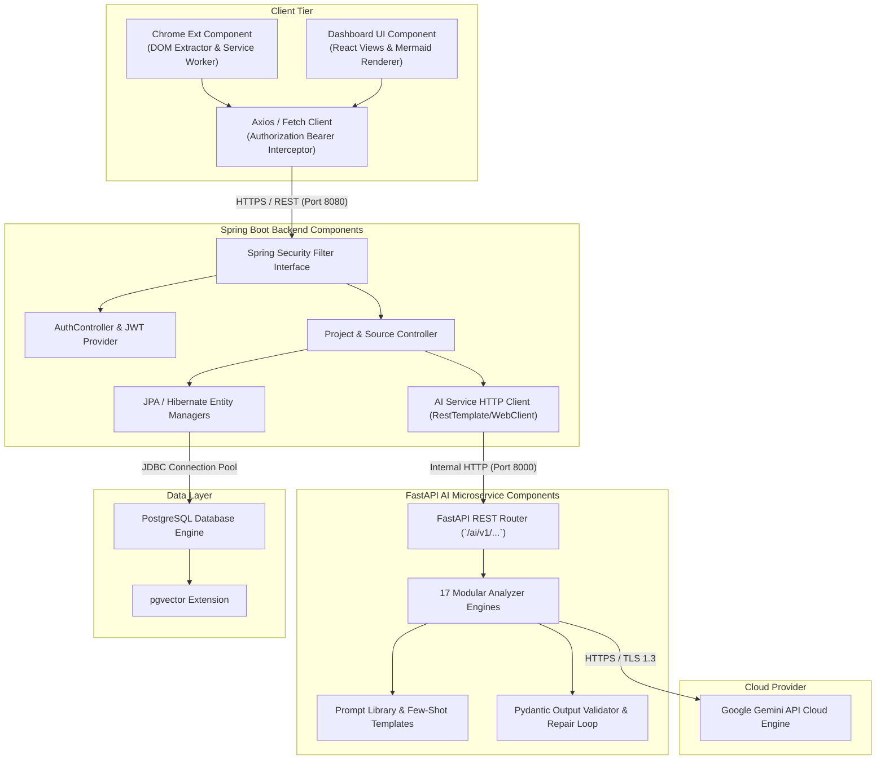

---

### 7.7 Deployment Diagram
Shows the physical and containerized nodes, execution environments, and network topology across local development and production cloud infrastructure.

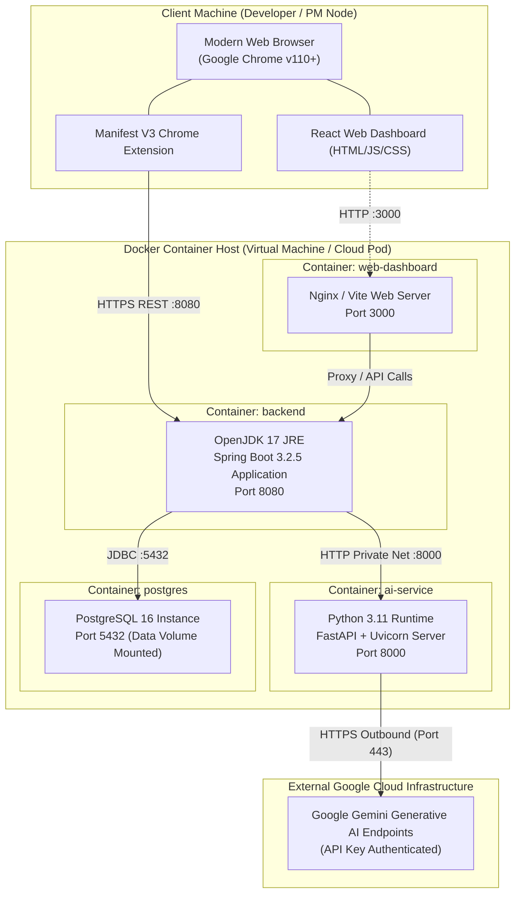

---

## 8. Database Design & Entity Relationship Diagram (ERD)

### 8.1 Database Architecture Overview
- **Engine**: PostgreSQL 16
- **Extensions Installed**: `uuid-ossp` (guaranteeing globally unique, collision-free identifiers) and `vector` (for vector embeddings supporting similarity search).
- **Audit Standard**: Every transactional table enforces `created_at`, `updated_at`, and `deleted_at` (soft deletes with partial indexes).
- **Referential Integrity**: Cascading foreign keys (`ON DELETE CASCADE`) are applied across hierarchical parent-child relationships (e.g., deleting a Project purges its generated Requirements, Architectures, and Sprints).

---

### 8.2 Entity Relationship Diagram (ERD) (Mermaid)

```mermaid
erDiagram
    users ||--o{ project_members : belongs_to
    roles ||--o{ user_roles : assigned_to
    users ||--o{ user_roles : has
    projects ||--o{ project_members : contains
    projects ||--o{ sources : has
    sources ||--o{ source_documents : contains
    source_documents ||--o{ source_embeddings : vectorizes
    projects ||--o{ requirements : generates
    projects ||--o{ features : generates
    projects ||--o{ architectures : generates
    architectures ||--o{ architecture_components : contains
    projects ||--o{ database_designs : generates
    database_designs ||--o{ database_entities : contains
    projects ||--o{ api_definitions : generates
    projects ||--o{ tech_stack_recommendations : recommends
    projects ||--o{ wireframes : generates
    projects ||--o{ sprints : plans
    sprints ||--o{ tasks : contains
    projects ||--o{ milestones : tracks
    projects ||--o{ cost_estimates : estimates
    projects ||--o{ risks : predicts
    projects ||--o{ documents : outputs
    projects ||--o{ conversations : hosts
    conversations ||--o{ messages : includes
    projects ||--o{ integrations : configures
    users ||--o{ notifications : receives
    projects ||--o{ activity_logs : records
    projects ||--o{ exports : exports

    users {
        uuid id PK
        string email UK
        string password_hash
        string full_name
        boolean is_active
        timestamp created_at
    }

    projects {
        uuid id PK
        string title
        text description
        uuid owner_id FK
        string status
        int health_score
        timestamp created_at
    }

    sources {
        uuid id PK
        uuid project_id FK
        string source_type
        string source_url
        text raw_content
        timestamp created_at
    }

    requirements {
        uuid id PK
        uuid project_id FK
        string requirement_type
        string title
        text description
        string priority
        string taxonomy_tag
    }

    architectures {
        uuid id PK
        uuid project_id FK
        string style
        text mermaid_diagram
        text deployment_strategy
    }

    database_designs {
        uuid id PK
        uuid project_id FK
        string dbms
        text ddl_sql
        text mermaid_er
    }

    sprints {
        uuid id PK
        uuid project_id FK
        string name
        int sprint_number
        date start_date
        date end_date
    }

    tasks {
        uuid id PK
        uuid sprint_id FK
        string title
        text description
        int story_points
        string status
    }

    risks {
        uuid id PK
        uuid project_id FK
        string category
        text description
        int probability
        int impact
        int severity_score
        text mitigation_strategy
    }
```

---

### 8.3 Core Data Dictionary / Key Table Definitions

#### Table 1: `users`
| Column Name | Data Type | Constraints | Description |
| :--- | :--- | :--- | :--- |
| `id` | UUID | PRIMARY KEY, DEFAULT uuid_generate_v4() | Unique user identifier |
| `email` | VARCHAR(255) | UNIQUE, NOT NULL | Account email address |
| `password_hash` | VARCHAR(255) | NOT NULL | BCrypt salted hash (strength 12) |
| `full_name` | VARCHAR(255) | NOT NULL | Full name of the user |
| `avatar_url` | TEXT | NULLABLE | Profile picture URL |
| `is_active` | BOOLEAN | DEFAULT TRUE | Account operational status |
| `created_at` | TIMESTAMP TZ | DEFAULT CURRENT_TIMESTAMP | Audit timestamp |

#### Table 2: `projects`
| Column Name | Data Type | Constraints | Description |
| :--- | :--- | :--- | :--- |
| `id` | UUID | PRIMARY KEY, DEFAULT uuid_generate_v4() | Project identifier |
| `title` | VARCHAR(255) | NOT NULL | Human-readable project title |
| `description` | TEXT | NULLABLE | Detailed project overview |
| `owner_id` | UUID | NOT NULL, REFERENCES users(id) | Project creator foreign key |
| `status` | VARCHAR(50) | DEFAULT 'PLANNING' | Project lifecycle status |
| `health_score` | INT | DEFAULT 100 | Architectural feasibility index |

#### Table 3: `requirements`
| Column Name | Data Type | Constraints | Description |
| :--- | :--- | :--- | :--- |
| `id` | UUID | PRIMARY KEY, DEFAULT uuid_generate_v4() | Unique requirement identifier |
| `project_id` | UUID | NOT NULL, REFERENCES projects(id) | Associated project foreign key |
| `requirement_type`| VARCHAR(50) | NOT NULL | `FUNCTIONAL`, `NON_FUNCTIONAL`, `USER_STORY` |
| `title` | VARCHAR(255) | NOT NULL | Requirement short title |
| `description` | TEXT | NOT NULL | Detailed requirement statement |
| `priority` | VARCHAR(20) | NOT NULL | `CRITICAL`, `HIGH`, `MEDIUM`, `LOW` |
| `taxonomy_tag` | VARCHAR(50) | NOT NULL | `FACT`, `INFERENCE`, `RECOMMENDATION`, `ASSUMPTION` |

#### Table 4: `architectures`
| Column Name | Data Type | Constraints | Description |
| :--- | :--- | :--- | :--- |
| `id` | UUID | PRIMARY KEY, DEFAULT uuid_generate_v4() | Unique architecture identifier |
| `project_id` | UUID | NOT NULL, REFERENCES projects(id) | Associated project foreign key |
| `style` | VARCHAR(100)| NOT NULL | E.g. `MODULAR_MONOREPO`, `MICROSERVICES` |
| `mermaid_diagram` | TEXT | NOT NULL | Valid Mermaid.js diagram definition string |
| `deployment_strategy`| TEXT | NULLABLE | Containerization / Cloud deployment details |

---

## 9. AI Microservice Architecture & Anti-Hallucination Framework

### 9.1 The 17 Specialized Domain Engines
Rather than delegating all planning tasks to a generic monolithic prompt, Project Pilot divides cognitive labor across 17 distinct analyzer engines (`apps/ai-service/app/services/`):
1. **`requirement_analyzer.py`**: Extracts functional and non-functional requirements with acceptance criteria.
2. **`domain_identifier.py`**: Categorizes application industry (FinTech, HealthTech, E-commerce, EdTech, SaaS).
3. **`research_gap_finder.py`**: Discovers missing market features compared to competitor benchmarks.
4. **`feature_predictor.py`**: Formulates prioritized core and innovative feature matrices.
5. **`complexity_analyzer.py`**: Evaluates algorithmic, infrastructural, and integration complexity.
6. **`feasibility_analyzer.py`**: Assesses technical and economic feasibility.
7. **`architecture_generator.py`**: Produces component hierarchies and valid Mermaid.js diagrams.
8. **`database_designer.py`**: Formulates 3NF entity-relationship tables and PostgreSQL DDL scripts.
9. **`api_generator.py`**: Designs OpenAPI 3.0 specs and REST endpoints.
10. **`tech_stack_recommender.py`**: Selects libraries and frameworks with architectural justification.
11. **`wireframe_generator.py`**: Generates ASCII / layout UI wireframes for key screens.
12. **`sprint_planner.py`**: Organizes features into sprint backlogs and Fibonacci story points.
13. **`timeline_generator.py`**: Constructs Gantt schedules with project milestones.
14. **`cost_estimator.py`**: Models cloud compute, database, and operational expenditures.
15. **`risk_predictor.py`**: Calculates probability-impact severity risk scores (1-10 scale).
16. **`documentation_generator.py`**: Assembles comprehensive IEEE 830 compliant SRS documents.
17. **`code_structure_generator.py`**: Generates enterprise folder directory structures.

### 9.2 Strict Taxonomy Rules
Every generative statement produced by the AI engines must be tagged with one of five taxonomy values:
- `FACT`: Directly verified from provided source text or repository files.
- `INFERENCE`: Logically derived based on standard engineering patterns.
- `RECOMMENDATION`: Suggested architectural choices with technical justification.
- `ASSUMPTION`: Unstated constraints assumed to hold true (e.g., target user base size).
- `UNKNOWN`: Explicitly identified missing information.

### 9.3 Pydantic Self-Repair Fallback Algorithm
```
Input: Prompt (P), Schema (S), MaxRetries = 2
Output: Validated Schema Object

For attempt = 0 to MaxRetries:
    RawResponse = CallGeminiAPI(P)
    CleanedJSON = ExtractJSONBlock(RawResponse)
    Try:
        ValidatedObj = S.validate_json(CleanedJSON)
        Return ValidatedObj
    Catch ValidationError as E:
        If attempt == MaxRetries:
            Raise HTTP_522_AI_Schema_Repair_Failed
        P = "Your previous output failed validation with error: " + str(E) + 
            "\nOriginal prompt: " + P + 
            "\nFix the JSON output to strictly match schema."
```

---

## 10. Conclusion & Future Enhancements

### 10.1 Conclusion
Project Pilot bridges the divide between conceptual ideation and actionable technical execution. By combining a modern multi-service architecture (Spring Boot 3.2, Python FastAPI, React 18, PostgreSQL 16) with specialized Google Gemini 1.5/2.0 AI models, strict Pydantic JSON validation, and automated Mermaid diagram rendering, Project Pilot reduces software planning cycles from weeks to minutes. It eliminates human transcription error, enforces architectural best practices, and delivers enterprise-grade specifications ready for immediate engineering execution.

### 10.2 Future Roadmap & Enhancements
1. **GitHub Pull Request Bot**: Automated repository scaffolding that directly opens a Git Pull Request containing the generated folder structure, Dockerfiles, and database migrations.
2. **Figma Vector Ingestion**: Direct Figma API integration to automatically parse UI components, tokens, and design hierarchies into React Tailwind CSS templates.
3. **CI/CD Pipeline Generator**: Automatic formulation of GitHub Actions and GitLab CI workflows tailored to the recommended tech stack.
4. **Cost Real-Time Synchronization**: Live integration with AWS Cost Explorer and Google Cloud Pricing APIs to fetch dynamically updating infrastructure rate cards.
